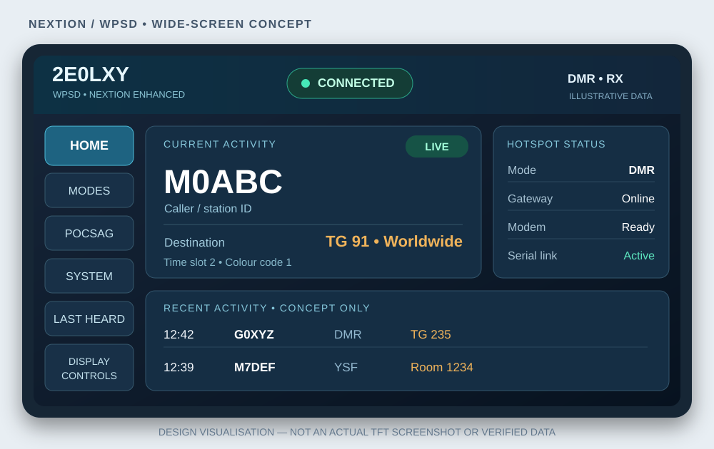
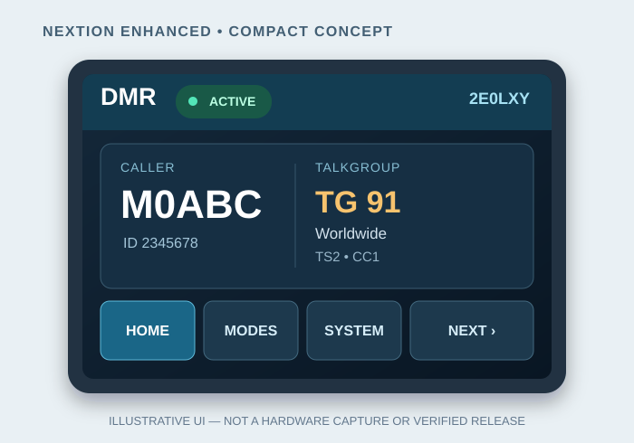
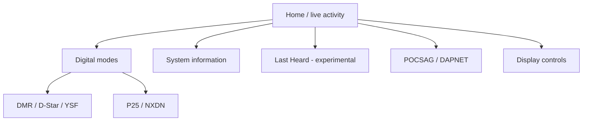

# Nextion dashboards for W0CHP / WPSD

**Multi-page amateur-radio hotspot dashboards for Nextion Enhanced touchscreen displays.**

Designed for the W0CHP **WPSD** (formerly W0CHP-PiStar-Dash) environment, with dedicated layouts for **3.2, 3.5, 4.3 and 7 inch** Nextion Enhanced screens. The design brings live digital-mode activity, hotspot status, operator details and touchscreen navigation together in one place.

> [!IMPORTANT]
> **Project status — compiled TFT preview builds available.** Four v4.4 Native `.tft` files are provided under [`firmware/`](firmware/). They have passed build and integrity checks but **have not been tested on physical Nextion panels or connected WPSD hardware**. Do not assume all described functions work until hardware-tested. Editable `.hmi` projects and source code are not distributed.



*Illustrative layout concept — not a photograph or screenshot from a compiled display. Actual layouts and available fields may differ by screen size and WPSD configuration.*

## Contents

- [At a glance](#at-a-glance)
- [Screen sizes and compatibility](#screen-sizes-and-compatibility)
- [Pages and feature catalogue](#pages-and-feature-catalogue)
- [Touchscreen controls](#touchscreen-controls)
- [Data sources and limitations](#data-sources-and-limitations)
- [Getting a TFT file](#getting-a-tft-file)
- [Installing on a Nextion display](#installing-on-a-nextion-display)
- [Configuring WPSD](#configuring-wpsd)
- [Using the dashboard](#using-the-dashboard)
- [Troubleshooting](#troubleshooting)
- [FAQ](#faq)
- [Privacy, licensing and support](#privacy-licensing-and-support)

## At a glance

| Area | Dashboard design goal |
| --- | --- |
| **Live activity** | Current mode, callsign/ID, destination or talkgroup, receive/transmit activity and connection state where supplied by WPSD. |
| **Digital voice** | Separate pages for **DMR, D-Star, YSF/C4FM, P25 and NXDN**. |
| **Paging** | **POCSAG / DAPNET** receive-status and message-oriented display, subject to data being available from the WPSD interface. |
| **System information** | Hotspot identity, software/modem status, network details, uptime and other diagnostics when obtainable without extra services. |
| **Lookups** | Operator/callsign and DMR talkgroup identification where supplied by the host and its databases. |
| **Last Heard** | Experimental recent-activity view, dependent on what the existing WPSD/Nextion data path exposes. |
| **Touchscreen** | Page navigation, home/back, list movement, on-screen refresh and display/backlight controls. |
| **Installation approach** | Use WPSD's **existing** Nextion support wherever possible; no mandatory third-party script or daemon on the hotspot is part of the design brief. |

WPSD itself supports the above digital-voice modes and POCSAG, but **WPSD support for a mode is not proof that every field or control is available over the Nextion serial interface**.

## Screen sizes and compatibility

These are **four separate build targets**, not one interchangeable TFT file.

| Display | Example Nextion Enhanced model | Native resolution | Layout approach | Build status |
| --- | --- | --- | --- | --- |
| **3.2 in** | `NX4024K032` | 400 × 240 | Compact overview, prioritised data and additional pages | Compiled preview; hardware untested |
| **3.5 in** | `NX4832K035` | 480 × 320 | Detailed compact dashboard; primary design target | Compiled preview; hardware untested |
| **4.3 in** | `NX4827K043` | 480 × 272 | Wider, shallower pages with larger touch targets | Compiled preview; hardware untested |
| **7 in** | `NX8048K070` | 800 × 480 | Spacious multi-panel overview and more detail per page | Compiled preview; hardware untested |

Check the **full model number on the back of your display** before choosing a file. This family targets the classic **Nextion Enhanced (`K`)** models, not automatically the Basic (`T`), Intelligent (`P`) or newer OpenNextion boards. Model suffixes and orientation may matter. A matching screen diagonal alone is not enough.

The intention is a common feature set across all four sizes, with page count, density and button placement adapted to each resolution. Some advanced features may be omitted if hardware resources or the host interface cannot support them reliably.

### Visual example: compact versus wide



*Concept only: the smaller screens use fewer simultaneous panels and more pages. These images are not evidence of a released or tested TFT build.*

## Pages and feature catalogue

The following catalogue records the **planned pages and behaviours**. Fields are displayed **only when meaningful data is provided**; unavailable values should be hidden, marked `N/A` or shown as unavailable rather than fabricated.

### 1. Home / overview

The main operating view is intended to show, at a glance:

- Hotspot callsign or node identity; WPSD software/host identification.
- Active operating mode and whether the hotspot is idle, receiving, transmitting or disconnected.
- Current caller/callsign or numeric station ID.
- Talkgroup, reflector, room, destination or other mode-specific routing information.
- Radio activity indicators and the most useful available status/error indicator.
- Direct shortcuts to mode-specific pages, System, Last Heard and Settings.

### 2. DMR

- DMR caller callsign / numeric DMR ID and, when available, name or country.
- Talkgroup number and resolved talkgroup name where supported.
- Slot 1 / Slot 2 and colour code when exposed by WPSD and the modem.
- Network or gateway information where known, including BrandMeister/TGIF/other configured networks.
- Current activity and connection status.

**Note:** A visible talkgroup is not necessarily a persistent static talkgroup. BrandMeister, TGIF and other DMR networks handle linking differently. This display does not itself reconfigure static talkgroups unless a supported, tested command path is explicitly documented for a release.

### 3. D-Star

- Callsign and destination/routing fields where available.
- Reflector/module information and linked/idle status.
- Activity details and return navigation.

### 4. YSF / C4FM

- YSF operating state and linked reflector/room.
- Station details and current activity where available.
- Connection indication and page navigation.

### 5. P25

- P25 caller/unit information, destination talkgroup and connected reflector when available.
- Mode and activity state.

### 6. NXDN

- NXDN caller/unit and talkgroup information when available.
- Reflector/room information and mode state.

### 7. POCSAG / DAPNET paging

- POCSAG/DAPNET mode and gateway status, where exposed.
- Received paging-message details **only if the existing host interface actually provides them to the display**.
- Readable handling of longer text, message boundaries and timestamps when supplied.
- A clear distinction between **receiving a page over RF** and **submitting a page to the DAPNET network**.

**Sending messages:** A DAPNET account does not, by itself, make a touchscreen Send button possible. Sending from the Nextion requires an authenticated, supported host-side action and must not be claimed as implemented by the built-in serial driver. No credentials should be stored in a public TFT file. This remains an integration item, not a released feature.

### 8. System information

The system page is intended to consolidate the information people otherwise have to find through the web dashboard:

| Category | Candidate information | Availability caveat |
| --- | --- | --- |
| Identity | Hotspot callsign, node name, configured frequency | Common configuration data; serial exposure varies. |
| WPSD | Distribution/version, active modes, host/gateway state | Only fields exposed to the display. |
| MMDVM | Modem/display link, simplex/duplex, firmware details | Hardware and driver dependent. |
| Network | IP address, local connectivity, gateway/network state | Network diagnostics are not necessarily part of Nextion output. |
| Raspberry Pi / host | Uptime, temperature, CPU load, memory, storage | **Not guaranteed** by the built-in driver; cannot be conjured by a TFT alone. |
| Time | Current time, last update, data age | Requires an appropriate host or display time source. |

The **no-extra-installation preference** takes precedence over optional diagnostics: unsupported fields should stay unavailable unless a future release clearly describes an opt-in integration.

### 9. Operator and talkgroup lookups

- Display resolved callsign/name/location/country and talkgroup text where provided by existing WPSD data.
- Fall back to numeric IDs or callsigns if lookup data is unavailable or stale.
- No assumption that a Nextion display can directly browse the internet or query external lookup APIs.
- Lookup detail may be disabled on lower-powered WPSD hardware.

### 10. Last Heard — experimental

- Recent station/activity list, ideally with mode, caller, destination and time.
- Scroll/paging on the screen if suitable records are made available.
- Stale-data and empty-list handling.

WPSD publishes a **Last Heard JSON API** for external consumers, but this does **not** mean the native Nextion driver forwards that API's records to a TFT. The display-only implementation is experimental until an end-to-end path has been verified, without requiring additional hotspot software.

### 11. Settings / display controls

- Navigate to a requested page; Home and Back where relevant.
- Manual display refresh or redraw without changing radio configuration.
- Brightness and idle dimming, within supported Nextion/WPSD controls.
- Clear indications for settings that are display-local versus settings controlled by WPSD.

## Touchscreen controls

| Control | Intended action | Safety/availability |
| --- | --- | --- |
| **Home / Back** | Change display page | Local HMI action. |
| **DMR / D-Star / YSF / P25 / NXDN / POCSAG tabs** | Open that mode's page | Navigation does not enable/disable modes. |
| **Next / Previous / Scroll** | Move through page content | Only when content exists. |
| **Refresh** | Redraw/re-request supported display data | Does **not** restart gateways or alter RF settings. |
| **Brightness / Dim** | Adjust supported screen backlight behaviour | Avoid conflicting with WPSD's idle-brightness setting. |
| **Radio/network commands** | Potential future supported actions | **Not enabled or promised** without confirmed bidirectional driver support and explicit safety checks. |

Touch interaction with the **display itself** is different from remote control of **WPSD**. A button can navigate a page locally without any host-side command support. The roadmap favours safe, reversible actions and avoids service restarts, mode changes or talkgroup changes that the stock WPSD interface does not expressly support.

### Page navigation concept



The number of pages and shortcuts can vary between the four display sizes.

## Data sources and limitations

The dashboard is **a display client**, not a replacement for WPSD, a new digital voice gateway or an independent RF decoder.

| Item | Origin | What to expect |
| --- | --- | --- |
| Current mode / live caller | WPSD/MMDVMHost and configured gateways | Shown when forwarded through the selected Nextion layout protocol. |
| Station and talkgroup names | WPSD databases and supported lookups | IDs may be shown when a name is missing. |
| DAPNET / POCSAG service | WPSD's existing paging support | Gateway operation does not guarantee display access to complete message text. |
| Last Heard list | WPSD dashboard and `/api` | API availability does not equal native TFT serial support. |
| Pi hardware statistics | WPSD/host | Not guaranteed without a separate supported transport. |
| Touch commands | Nextion local events and any WPSD-recognised serial actions | Most actions are local; host control is not assumed. |

The initial design aims to avoid **extra installation or modification on the Pi-Star/WPSD host**. If a requested function cannot be delivered by WPSD's existing interface, it will be labelled limited or deferred rather than quietly requiring a background daemon.

**Compatibility is protocol-specific:** WPSD offers Nextion layout choices such as `G4KLX`, `ON7LDS L2`, `ON7LDS L3` and `ON7LDS L3 HS`. A released TFT must identify which one it speaks. Do not choose one at random; a layout/protocol mismatch can leave fields blank or mapped incorrectly.

## Getting a TFT file

1. Open the [`firmware/`](firmware/) folder and select the appropriate compiled preview build.
2. Download the `.tft` that matches the **exact display model**, not just screen size.
3. Check the compatibility notes below, the display model, known limitations and the `firmware/SHA256SUMS` manifest.
4. Keep a copy of your current working TFT file if you have one.

**Present availability:** compiled, integrity-checked v4.4 Native previews exist for all four sizes. **Hardware verification is still outstanding.** The builds use a 9600-baud serial setting and native G4KLX mode pages, with ON7LDS-dependent telemetry and lookup fields when supported by the installed driver. Advanced messaging and DAPNET sending are not implemented.

Current files in [`firmware/`](firmware/):

```text
Nextion-WPSD-3.2-NX4024K032-v4.4.0.tft
Nextion-WPSD-3.5-NX4832K035-v4.4.0.tft
Nextion-WPSD-4.3-NX4827K043-v4.4.0.tft
Nextion-WPSD-7.0-NX8048K070-v4.4.0.tft
```

## Installing on a Nextion display

> [!CAUTION]
> Only flash a **verified TFT for your exact hardware model**. A failed or mismatched update may require recovering the display with a known-good file. Do not interrupt power during upload.

The usual classic Nextion microSD method is:

1. Confirm your screen's model and obtain its matching `.tft` release file.
2. Prepare a compatible **FAT32-formatted microSD card** according to Nextion's guidance. Keep a backup of the card if it contains anything important.
3. Copy **one** matching `.tft` file to the **root** of that card (not in a folder). Remove unrelated `.tft` files.
4. Power **off** the Nextion/hotspot, insert the card into the display's microSD slot and restore power.
5. Allow the upload to finish without interruption; follow the completion message on the display.
6. Power off again, **remove the microSD card**, then restart the display.
7. Verify the splash/home page, touch navigation and live updates after completing WPSD configuration below.

The `.tft` is the compiled file that runs on the screen. The `.hmi` is the editable Nextion Editor project and is **not needed by an end user** to flash the display. This repository is intended to distribute compiled `.tft` files only.

## Configuring WPSD

1. In your browser, sign into the local WPSD dashboard (often `http://wpsd.local`, or your hotspot's configured hostname/IP address).
2. Go to **Configuration → MMDVMHost/Modem Display Configuration**.
3. Choose the applicable **MMDVM Display Type**:
   - `Nextion`
   - `Nextion (enhanced w/driver)`
   - `Nextion (enhanced w/driver, attached to modem)`
4. Set the correct **Display Port** for your physical USB/UART/modem wiring.
5. Select the **Layout Type** specifically stated in the matching TFT release notes.
6. Adjust **Idle Brightness** if desired. Apply/save the configuration using WPSD's normal process.
7. Confirm that WPSD is working in its web dashboard, then test a live transmission and the display's navigation.

WPSD's Layout Type dropdown **does not flash the TFT**. WPSD already includes its Nextion integration options: the project aims to use those capabilities without installing custom drivers, scripts or new services. If you are using **classic Pi-Star rather than WPSD**, do not assume its display menu or driver behaves identically; compatibility requires separate verification.

For the canonical up-to-date instructions, see the official [WPSD display configuration guide](https://manual.wpsd.radio/initial_startup/#display-configuration).

## Using the dashboard

1. Start from **Home** to see the current mode and live activity.
2. Open the matching **digital-mode page** for the most relevant fields.
3. Use **System** to review available hotspot/display status; `N/A` means data was not provided.
4. Use **Last Heard** only on releases that specifically advertise and verify the feature.
5. Use **POCSAG/DAPNET** to view supported paging status. Do not mistake this for a confirmed network message-send function.
6. Use **Display controls** for brightness, local refresh and navigation.

An idle or disconnected display should clearly distinguish **no recent traffic**, **mode disabled**, **host disconnected** and **data unavailable** wherever the interface gives enough information to do so.

## Troubleshooting

| Symptom | Checks |
| --- | --- |
| **No image / stays on old layout** | Check exact model, TFT suitability, microSD format, single file in root, flash completion and card removal. |
| **Screen lights but shows no activity** | Check MMDVM Display Type, serial port, WPSD service status and that a known live transmission appears in the web dashboard. |
| **Incorrect labels or blank mode fields** | Confirm that WPSD's **Layout Type** matches the release's required protocol. Unsupported fields may correctly show `N/A`. |
| **Touch changes pages but does not change a talkgroup or service** | Page navigation is local; host-control commands are not necessarily implemented or supported. |
| **Lookups show only numbers** | Database records may be absent or stale; WPSD can disable costly lookups on low-power hosts. |
| **No Last Heard list** | Experimental feature; the WPSD web/API list may not be passed over the serial display link. |
| **No DAPNET message body** | WPSD paging support does not guarantee a message feed for the Nextion. Check the gateway first. |
| **Brightness appears to reset** | Check WPSD Idle Brightness and any display-local brightness action. |
| **Display worked before the upgrade** | Restore your known-good TFT; record the display model, WPSD version and driver/layout setting before reporting an issue. |

For host-side faults, use the WPSD dashboard's logs and the official [WPSD troubleshooting guide](https://manual.wpsd.radio/troubleshooting/). A non-working digital mode in WPSD itself is not something a TFT layout can repair.

## FAQ

**Do I need to install anything on my WPSD hotspot?**  
The design goal is **no additional Pi-side installation** beyond the built-in WPSD Nextion support. Features that need unsupported data or commands remain conditional; they are not promised by the TFT file alone.

**Can one TFT be used on 3.2, 3.5, 4.3 and 7 inch displays?**  
No. Each size/model needs the appropriate compiled build and layout.

**Can I use a Basic or Intelligent Nextion?**  
Do not assume so. The named targets are **Enhanced** models. An alternative model needs its own tested build.

**Can I send DAPNET messages from the touchscreen?**  
Not as a verified stock-WPSD/Nextion capability. Receiving or transmitting paging traffic through WPSD is a separate matter from sending a newly composed message from a touchscreen. This requires a documented, authenticated path before it can be offered.

**Is Last Heard live?**  
WPSD has live-activity data and a Last Heard API, but a standalone TFT does not automatically have API access. Treat the display view as experimental until verified.

**Does pressing a mode tab change the current radio mode?**  
No. It navigates to a screen. Reconfiguring modes is separate and controlled by WPSD.

**Why do some fields show `N/A`?**  
Different modes, modems, host systems and layout protocols supply different fields. An honest unavailable indicator is better than displaying old or invented values.

**Where is the `.hmi` project file?**  
The distribution policy is **compiled `.tft` files only**, so the editable HMI/project code is not published.

## Privacy, licensing and support

- This is an **independent, unofficial dashboard project**. It is not an official WPSD, W0CHP, Pi-Star, Nextion, DAPNET or BrandMeister release.
- Callsigns, station names, talkgroups, paging messages and network details may be visible to anyone able to see the physical display. Use discretion when displaying private messages or network information.
- Never embed DAPNET passwords, API tokens or other secrets in a publicly distributed TFT or README.
- Only distribute binaries and visuals for which you have rights; a third-party logo or screenshot is not automatically reusable.
- Before reporting a bug, include **display model, TFT version (if published), WPSD version, connection/port, Layout Type, steps to reproduce and a photo** where helpful. Remove personal information and secrets from logs or screenshots.
- For feature requests and reproducible dashboard issues, use this repository's [Issues](../../issues). For WPSD itself, consult its [official manual](https://manual.wpsd.radio/).

### Reference documentation

- [WPSD User Manual — display setup](https://manual.wpsd.radio/initial_startup/#display-configuration)
- [WPSD User Manual — supported modes](https://manual.wpsd.radio/)
- [WPSD User Manual — live activity and operation](https://manual.wpsd.radio/operations/)
- [WPSD User Manual — Last Heard API](https://manual.wpsd.radio/advanced/api/)
- [Nextion official website](https://nextion.tech/)

---

**Project maintained by [2E0LXY](https://github.com/2E0LXY).**  
*Document revision: 8 November 2026. Hardware compatibility and release status must be confirmed against each published TFT build.*
